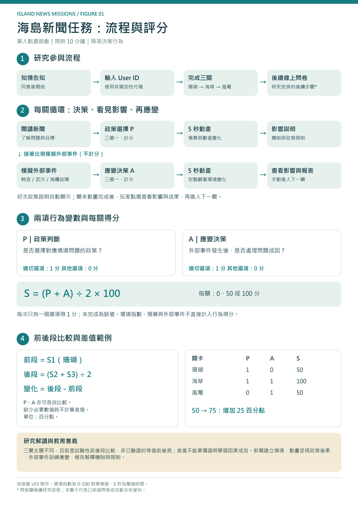
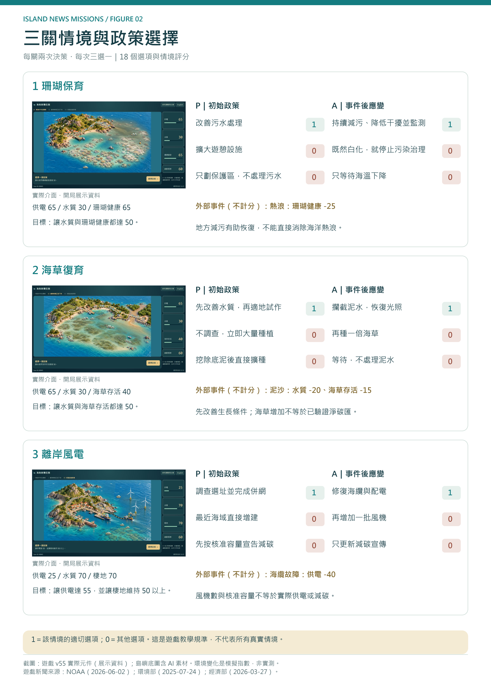
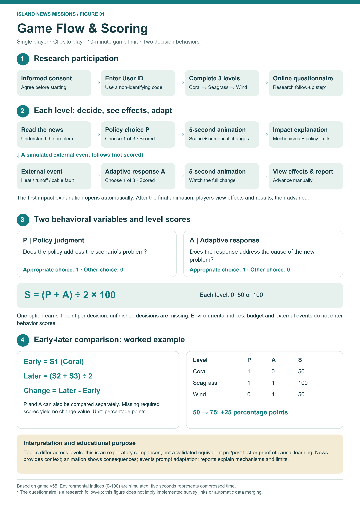
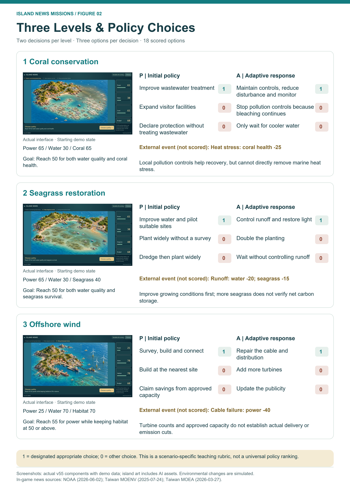

# 海島新聞任務｜Island News Missions

透過真實新聞認識海洋政策，用決策改變海島環境。這是一款 **單人、點選操作、10 分鐘內完成** 的網頁政策教育遊戲，支援中文與英文。

**[立即遊玩：Cloudflare Version 2](https://oceanpolicy-v2.nthuchwu.workers.dev)** · [原版 ChatGPT Sites](https://ocean-policy-dispatch.nthuchwu.chatgpt.site)


## 怎麼玩？

1. 閱讀研究參與告知；同意後輸入自行設定的 User ID，請勿使用姓名或電子郵件。
2. 閱讀彩色新聞報紙，了解當關的環境問題與任務。
3. 點選政策，觀看約 **5 秒的建設／環境變化動畫**，再查看數值增減與原因。
4. 面對熱浪、泥沙或海纜故障等模擬事件，再選擇應變政策。
5. 看完本關環境變化與成果報告，再進入下一關；最後查看三關總結。

不需要登入 ChatGPT。圖片為事先生成的素材，遊玩期間不需要呼叫 AI 模型。若參與研究，完整遊玩後還需填寫研究者提供的後續問卷；問卷連結與資料整合需另外設定。

## 三關內容

| 關卡 | 面對的問題 | 決策重點 | 政策教育意涵 |
| --- | --- | --- | --- |
| 1．珊瑚保育 | 污水與海洋熱浪 | 污水治理、遊憩開發、保護區及持續減污 | 地方治理能減輕壓力，但不能直接消除海洋熱浪。 |
| 2．海草復育 | 混濁水質與暴雨泥沙 | 改善生長條件、種植策略、攔截泥水 | 種得多不代表存活高，也不能直接證明淨碳匯。 |
| 3．離岸風電 | 供電不足與海纜故障 | 選址、併網、擴建與海纜修復 | 風機數與核准容量，不等於實際供電或減碳成果。 |

每關有 **兩次決策、每次三個選項**。政策可以改善環境，也可能增加污染或棲地壓力；系統以場景、影響位置、數值增減及原因說明呈現結果。

環境數值為 **0–100 教學模擬指數**，不是實測排放量、溫度或碳匯；五秒動畫代表壓縮時間，並非真實環境能在五秒內恢復。

## 評分與進步怎麼算？

目前只衡量兩個行為變數：**政策判斷 P** 與 **應變決策 A**。每次決策依當關情境給 0 或 1 分；系統外部事件不計分，已移除證據選擇題。環境指數與行為得分分開計算。

| 項目 | 計算方式 |
| --- | --- |
| 每關分數 | `(P + A) ÷ 2 × 100`，可能為 0、50、100 分 |
| 前測／早期表現 | 第一關分數 |
| 後測／後期表現 | 第二關與第三關分數的平均 |
| 進步差值 | `後測 − 前測`，單位為百分點 |
| 個別變數 | 第一關該變數 × 100；後測為第二、三關該變數平均 × 100 |

例如第一關 50 分、第二關 100 分、第三關 50 分：後測為 75 分，差值 **+25 百分點**。未作答保留缺漏，不當成 0 分。

> 三關主題與回饋經驗不同，因此這是探索性的早期／後期表現比較，尚非經驗證的等值前後測，不能僅憑差值主張遊戲造成學習進步。

## 流程與評分說明圖

以下為既有 v55 中英文 A4 圖件；可開啟原圖供閱讀，投稿時請對照研究實際使用版本。



## 三關畫面與政策選項



<details>
<summary>English figures｜英文說明圖</summary>





</details>

## 系統架構與安裝

完整安裝、部署、Google Sheets 設定及備份方式請見 **[INSTALL.md](INSTALL.md)**。

`玩家瀏覽器 → 同網域網站 API → Google Apps Script → Google Sheets`

前端以 React 呈現新聞、SVG 動畫與政策結果；Cloudflare Workers 執行網站與資料驗證 API。研究同意後，系統才啟動遊玩紀錄上傳。

使用 Node.js 22.13 以上與 npm：

```sh
git clone https://github.com/profchwu/oceanpolicy.git
cd oceanpolicy
npm ci
npm run dev
```

```sh
npm test
npm run test:all-policies
npm run build
npm run preview
```

- [安裝、部署、移機與保存手冊（HTML）](readme.html)：下載後用瀏覽器開啟，四張 A4 圖已內嵌，可離線閱讀。
- [Google Apps Script 接收器](google-apps-script/NewsReceiver.gs)：使用私人設定連接研究試算表。
- [新聞原文來源與政策設定](lib/news-missions.ts) · [新聞報導內容](lib/news-articles.ts)。
- 圖片原檔在 `public/`；正式使用的壓縮 WebP 在 `public/optimized/`。

**本專案包含伺服器 API，不是可直接放上 GitHub Pages 的純靜態網站。** 移往其他主機時需處理伺服器環境與同網域 API，詳細步驟見 HTML 手冊。
